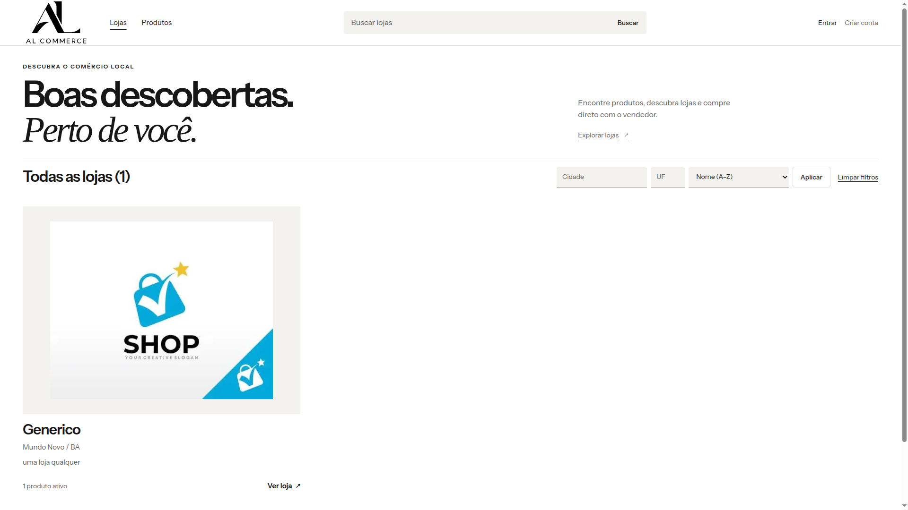
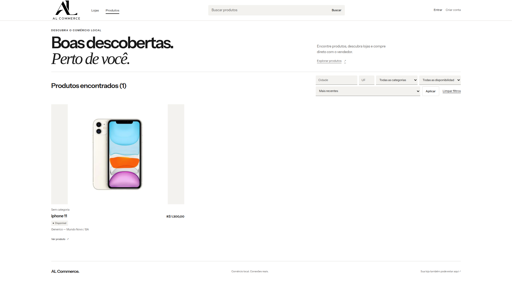
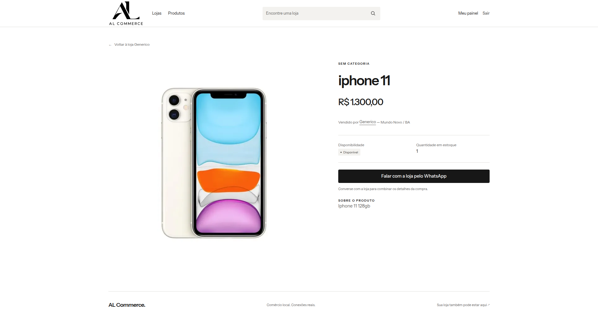
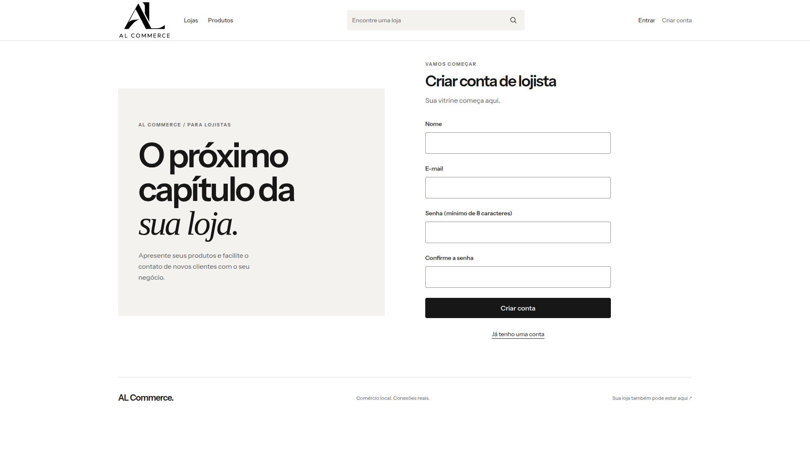
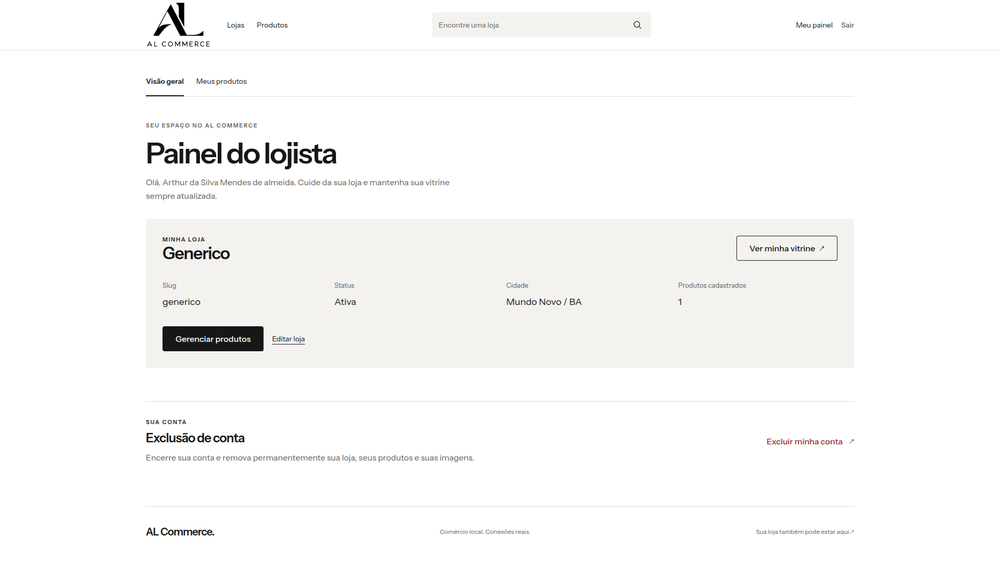

# AL Commerce

**Comércio local. Conexões reais.**

Uma plataforma de vitrines digitais que aproxima clientes e lojistas. No AL Commerce, o visitante descobre lojas da sua região, encontra produtos e conversa diretamente com o vendedor pelo WhatsApp. O lojista tem um espaço próprio para apresentar seu negócio e manter o catálogo atualizado.

Desenvolvido como projeto de portfólio com **Laravel, PHP e Blade**, o sistema reúne catálogo público, gestão de lojas e produtos, autenticação, verificação de e-mail e gerenciamento de imagens em uma interface minimalista e responsiva.

## A proposta

Dar visibilidade ao comércio local e facilitar o caminho entre descobrir um produto e falar com quem vende. A plataforma organiza as vitrines; a negociação acontece diretamente entre cliente e loja pelo WhatsApp, sem carrinho ou pagamento dentro do sistema.

O projeto tem duas áreas complementares: uma experiência pública para explorar lojas e produtos e um painel exclusivo para cada lojista administrar sua própria vitrine.

## Conheça a plataforma

### Descoberta de lojas

A home coloca as lojas em primeiro plano, com imagens, nome, localização, descrição e quantidade de produtos ativos. A busca fica acessível no topo, enquanto cidade, UF e ordenação aparecem em controles compactos próximos à listagem.

A navegação permite alternar entre lojas e produtos, aplicar filtros e percorrer os resultados com paginação. A seção de destaque evita repetir as mesmas lojas da listagem quando há poucos registros.

### Catálogo de produtos

Produtos apresentados com imagem, preço, categoria, disponibilidade e identificação da loja. Os filtros combinam termo de busca, localização, categoria, disponibilidade e ordenação, incluindo menor ou maior preço.

### Página do produto e contato direto

Cada produto possui uma página com galeria de imagens, descrição, preço, disponibilidade, estoque quando informado e acesso à loja responsável. O botão de WhatsApp abre uma conversa com uma mensagem que identifica o produto e inclui o link da página.

As lojas também contam com vitrines públicas próprias, reunindo apresentação do negócio, localização e catálogo com busca e filtros.

### Cadastro e acesso do lojista

O cadastro inicia o fluxo de verificação de e-mail. O acesso ao painel e ao gerenciamento de lojas e produtos exige a confirmação por um link assinado e com expiração. Uma tela dedicada permite acompanhar essa etapa e solicitar o reenvio da mensagem.

### Painel do lojista

Uma visão direta da loja: status, localização, endereço público e quantidade de produtos cadastrados. A partir do painel, o proprietário acessa sua vitrine, edita o negócio e gerencia o catálogo.

Cada conta pode ter uma loja. O lojista controla seus próprios dados, imagens e produtos, com ações para ativar ou desativar a publicação e uma área separada para excluir a conta definitivamente.

## Funcionalidades implementadas

| Área | Recursos |
| --- | --- |
| Descoberta | Busca de lojas e produtos, filtros por cidade e UF, ordenação e paginação. |
| Vitrines | Páginas públicas por loja, imagem de apresentação, localização, descrição e catálogo próprio. |
| Produtos | Cadastro, edição, exclusão, categoria opcional, preço, estoque e disponibilidade. |
| Imagens | Upload da imagem da loja, galeria de até seis imagens por produto e escolha da capa. |
| Publicação | Ativação e desativação de lojas e produtos, preservando os registros. |
| Contato | Integração por link do WhatsApp com mensagem contextual sobre a loja ou o produto. |
| Contas | Cadastro, login, logout, verificação obrigatória de e-mail e reenvio da confirmação. |
| Exclusão de conta | Confirmação por senha e pela palavra `EXCLUIR`, remoção dos dados vinculados e dos arquivos físicos. |

## Identidade visual

A interface usa preto, branco e tons neutros, com tipografia marcante, bastante respiro e foco nas imagens de lojas e produtos. A área pública e o painel compartilham a mesma linguagem visual.

Os componentes Blade mantêm consistência entre navegação, cards, botões, formulários, alertas e estados vazios. O layout se adapta a desktop, tablet e mobile, com filtros compactos, imagens proporcionais e estados de foco visíveis.

## Tecnologias

| Camada | Tecnologias |
| --- | --- |
| Backend | PHP 8.3 e Laravel 13. |
| Interface | Blade, CSS, Tailwind CSS 4 e JavaScript. |
| Assets | Vite 8 e Node.js 24. |
| Persistência | MySQL 8.4 e Eloquent ORM. |
| Autenticação | Sessões, Policies e verificação de e-mail nativa do Laravel. |
| E-mail | SMTP configurável, com suporte ao Gmail e Mailpit opcional no desenvolvimento. |
| Infraestrutura | Docker Compose, PHP-FPM, Nginx e scheduler Laravel. |
| Qualidade | PHPUnit, SQLite em memória, factories e Laravel Pint. |

## Arquitetura e modelagem

O backend organiza as responsabilidades entre **Controllers**, **Form Requests**, **Actions**, **Policies** e **Models**. As páginas são renderizadas no servidor com Blade, e os componentes reutilizáveis concentram os padrões de interface.

| Entidade | Papel no sistema |
| --- | --- |
| `User` | Representa o lojista, sua autenticação e a confirmação de e-mail. Pode possuir uma loja. |
| `Store` | Reúne os dados do negócio, a localização, a imagem e os produtos de um proprietário. |
| `Product` | Pertence a uma loja e concentra descrição, preço, estoque, disponibilidade e status de publicação. |
| `Category` | Organiza os produtos por categoria, com associação opcional. |
| `ProductImage` | Guarda a referência dos arquivos e a posição das imagens na galeria do produto. |

As vitrines e os produtos usam URLs com slugs. Os arquivos de imagem ficam em storage privado e são entregues por rotas que respeitam a autorização e as regras de visibilidade do catálogo.

## Segurança e integridade

- Gerenciamento restrito ao proprietário, com autenticação, e-mail verificado e autorização por Policies.
- Validação das entradas com Form Requests e proteção CSRF nos formulários.
- Senhas armazenadas com hash, renovação de sessão no login e invalidação no logout.
- Limitação de tentativas de login, reenvio de verificação e ações sensíveis.
- Links de verificação assinados, temporários e vinculados ao usuário autenticado.
- Validação de tipo e tamanho dos uploads e controle de acesso às imagens.
- Exclusão definitiva de conta com remoção dos registros e arquivos relacionados, além de recuperação de exclusões interrompidas pelo scheduler.

Desativar uma loja mantém seus dados. Excluir a conta encerra a sessão e remove definitivamente a loja, os produtos e as imagens vinculadas.

## Testes e qualidade

A suíte automatizada cobre autenticação e sessões, verificação de e-mail, autorização entre proprietários, validação dos formulários, buscas, filtros, paginação, slugs, imagens, exclusões e integridade dos relacionamentos.

Os testes utilizam SQLite em memória e transporte de e-mail em memória, isolados do MySQL e do SMTP de desenvolvimento. Há cobertura específica para esse isolamento, inclusive na execução em containers.

## Ambiente de desenvolvimento

O projeto pode ser executado localmente ou com Docker, mantendo as duas opções independentes. O Compose reúne os serviços `app`, `web`, `mysql`, `vite` e `scheduler`, com volumes próprios para banco, uploads, dependências e cache.

O Mailpit é opcional: o envio de e-mail pode continuar utilizando o SMTP configurado, incluindo Gmail. O Dockerfile também possui estágios para construir imagens de produção com assets compilados e dependências PHP sem os pacotes de desenvolvimento.

As configurações de referência estão em [`.env.example`](.env.example), [`.env.docker.example`](.env.docker.example), [`compose.yaml`](compose.yaml) e [`Dockerfile`](Dockerfile).

## Estado do projeto

O AL Commerce já possui a área pública e o painel do lojista implementados, com catálogo, gestão de produtos e imagens, contato por WhatsApp, verificação de e-mail e exclusão de conta.

O foco atual é consolidar uma experiência de marketplace para o comércio local, combinando apresentação visual, regras de acesso e integridade dos dados.
